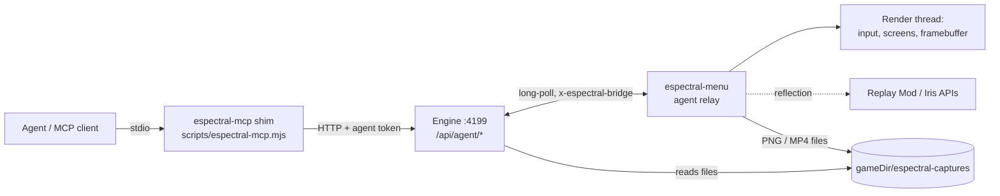

# Agent access & capture — plan (2026-10-30)

Status: **planned, not started.** Implementation + testing handed to the devLIN
agent (see "Handoff" at the bottom). Brainstorm context: the 2026-10-30 session
on devWIN1.

## Goals

1. **Testing** — an agent launches the *real* Espectral Client, reaches a known
   state (title / world / server), sees it and drives it: title menu, Suite,
   cosmetics, version ports. Protocol bots (Mineflayer/Azalea) can't do this —
   they never load `espectral-menu`. (Example of a bug only a real client
   catches: 26.3 renumbered mouse buttons, left = 1.)
2. **Content** — an agent shoots screenshots and records short-form video
   (9:16, 60 fps) **with shaders on**.
3. **Users can do the same** — opt-in, connect their own MCP client (Claude
   Code, Codex, Gemini CLI, Cursor…) to their own Espectral Client.

Non-goals: autonomous survival play / pathfinding / combat (Mineflayer's job);
any agent *control* on public Espectral servers.

## Research summary

| Option | Verdict |
|---|---|
| Mineflayer / Azalea | Keep for plugin/server tests and bot swarms. No rendering, no Espectral mod. Azalea is on 26.1; Mineflayer 26.x support unverified. |
| [Mine MCP](https://github.com/hashk014/Mine-MCP) (MIT, 1.14.4–26.3, no Fabric API) | Best reference for the in-client tool surface + safety (127.0.0.1 only, bearer token, F8 pause, 2 s input leases). Phase-0 spike candidate. |
| [Craftwire](https://github.com/uxplima/craftwire) (MIT, 26.2/26.3, needs Fabric API) | Reference for capture: framebuffer → ffmpeg recording, GUI-only transparent capture, detached camera, JSON scenarios. Its own launcher duplicates ours. |
| [mc-mcp](https://github.com/PowerRubik/mc-mcp) | Reference for "player-equivalent input only" (GrimAC-clean). |
| **Replay Mod 2.6.28** | On Modrinth for 1.21.11 / 26.2 / 26.3 (published 2026-10-18), officially supports Iris. Records packets cheaply, renders camera paths **offline, frame-locked** at any resolution via ffmpeg. **GPL-3** → download at install time like our other pins; never bundle or shade into the MIT `espectral-menu` jar; integrate as a soft (reflection) dependency. |
| Iris + Sodium | Already pinned per version in `src/engine/mods.mjs` (26.3: Iris 1.11.7 + Sodium 0.9.2 exactly). |

Key insight for content: real-time capture with shaders on a low-end GPU
(devLIN is an AMD Barcelo iGPU) drops frames. Smooth 60 fps clips on *any* PC
need an **offline, frame-locked render** — Replay Mod already does that with
Iris. Live capture stays useful for test evidence and quick clips.

## What exists today (reuse, don't duplicate)

- Launch API: `POST /api/instances/:name/launch` (`account`, `dry_run`), `POST …/stop`,
  `GET /api/launch/:key/log`, `GET /api/launches`, SSE `/api/events`.
- **Mod bridge** (`src/engine/bridge.mjs`): per-launch random token via
  `-Despectral.bridge.token`, URL via `-Despectral.bridge.url`, header
  `x-espectral-bridge`, registry `attach({instance, uuid, gameDir, token})`.
  Only route today: `POST /api/bridge/visible` (cosmetics presence).
- Version JSONs already carry `--quickPlaySingleplayer` / `--quickPlayMultiplayer`
  / `--width` / `--height` behind feature rules; `expandGameArgs(args, features)`
  in `launch.mjs` evaluates them — we just never enable those features.
- Mod: shared code in `branding-mod/src/main`, per-version overrides in
  `branding-mod/mc12111|mc262|mc263`; entrypoint `es.spectral.menu.EspectralClient`.

## Architecture

- **Relay, not a port in the mod.** The mod only makes outbound calls to the
  engine it already knows (bridge URL + token). The engine owns the stable
  address, auth, multi-client addressing by launch key, and survives game
  restarts.
  - `POST /api/bridge/agent/poll` — long-poll (~25 s), returns queued commands.
  - `POST /api/bridge/agent/result` — `{id, ok, data|error}`.
  - `POST /api/bridge/agent/state` — `{phase: title|loading|joining|in_world|disconnected, screen, server, world}`; engine re-emits as SSE `agent-state`.
  - Commands run on the render thread (`Minecraft.execute`), never on the
    relay thread.
- **Big payloads go through files**, not JSON: the mod writes PNG/MP4 under
  `<gameDir>/espectral-captures/`, the engine (knows `gameDir` from
  `bridge.attach`) reads them. MCP image results return a downscaled preview
  (≤1280 px wide); the full-res path is in the text result.
- **MCP transport: stdio shim** (`scripts/espectral-mcp.mjs`, shipped in the
  app bundle next to the bundled node). It reads `<data_dir>/agent-token`
  (0600, rotatable) and calls `/api/agent/*` with it. Reason: today non-GET
  routes only need `x-espectral-client: 1` (CSRF guard, not auth) — the agent
  surface needs a real secret. stdio is also the most portable across MCP
  clients.
- **Inert unless enabled.** The relay thread starts only when the JVM has
  `-Despectral.agent=1`, which the engine sets only for agent launches.

## Permission tiers (enforced in the mod; engine mirrors for clear errors)

| Tier | Tools | Allowed where |
|---|---|---|
| observe | `state`, `screen_tree`, `screenshot` (player view), `logs` | anywhere, agent mode on |
| capture | hi-res/portrait screenshot, `record` (player view), `hud`, `shaders` | anywhere (passive — records what the player already sees) |
| camera | detached camera / orbits / Replay Mod paths | singleplayer, replay viewer, spectator mode, or allowlisted servers (freecam on UHC = seeing through walls) |
| act | input, `click`, `type`, `chat`/`command`, GUI slot clicks | singleplayer, replay viewer, `localhost`, `agent.allowed_servers` allowlist. **Refused** on public Espectral hosts by default. |

Safety rails: F8 pauses agent input; held inputs expire after 2 s unless
renewed; opening a screen / world change releases held keys (Mine MCP
semantics). Chat, signs, item names are untrusted text — never instructions.

## Tool surface (v1)

Engine-level (no game needed):
- `launch {instance, account?, join?: {server}|{world}, window?: {width,height,hidden}, wait_for?: "title"|"in_world", timeout_s?}` → `{key, state}`
- `stop {key}`, `state {key}`, `logs {key, cursor?}`, `list_instances`, `list_launches`

In-client (relay):
- `screenshot {width?, height?, hud?: bool, preview?: bool}` — end-of-frame
  capture of the main render target **after** Iris composite. Custom size
  (e.g. 1080×1920, 4K) by resizing the main render target for one frame
  (spike: Iris must rebuild its targets — may need 2–3 frames).
- `screen_tree` — current `Screen` widgets incl. **our own** (title menu,
  Suite, cosmetics): stable id, class, text, bounds, enabled, focused;
  container slots with item id/name/lore.
- `click {id | x,y, button}` / `key {key, action}` / `type {text}` — routed
  through the same `MouseHandler`/`KeyboardHandler` entry points real input
  uses, so version-specific input bugs reproduce.
- `chat {text}` / `command {text}` — act tier.
- `hud {hidden}`; `shaders {enabled?, pack?}` via Iris API v0
  (`net.irisshaders.iris.api.v0.IrisApi` — verify method names on 1.11.7).
- `record start {preset?, width?, height?, fps?, out?}` / `record stop` —
  **live** capture: async PBO readback → `ffmpeg` stdin (rawvideo RGBA →
  H.264). Reports real achieved fps and dropped frames. No audio in v1.
- `clip render {replay?, camera: {orbit|path|keyframes}, preset}` —
  **cinematic** capture via Replay Mod (see below).

Presets: `short` = 1080×1920, 60 fps, HUD off, H.264 CRF 18, ≤60 s;
`landscape` = 1920×1080 60 fps; `evidence` = native size, 30 fps, HUD on.

## Content pipeline (cinematic)

1. Agent launches with Replay Mod present (engine installs the pinned
   Modrinth build when the instance has capture enabled) and plays/stages the
   scene; Replay Mod records packets (cheap, no GPU cost).
2. Agent opens the replay, sets camera keyframes (orbit around a point, path
   through points, time-lapse) through our soft-dependency wrapper over
   Replay Mod's render classes (exact classes on 2.6.28 = spike; fallback is
   driving its GUI through `screen_tree` + `click`).
3. Render with shaders at the preset resolution, frame-locked → MP4 in
   `espectral-captures/`. Slow GPU = slower render, never a choppy video.

ffmpeg: Linux uses the system binary; Windows needs the engine to provision a
static ffmpeg (download + sha256 pin, same pattern as JDK provisioning).
Shader packs: download from Modrinth (project_type `shader`) into
`shaderpacks/` at runtime; never bundle (licences vary).

## Engine changes

- `launch` body gains `agent`, `join`, `window`; map `join` → enable the
  `is_quick_play_singleplayer` / `is_quick_play_multiplayer` features +
  `quickPlay*` placeholders in `expandGameArgs`; `window` → `has_custom_resolution`.
  Hidden window: mod-side (`GLFW_VISIBLE` hint before window creation) when
  `-Despectral.agent.hidden=1`.
- `agent: true` adds `-Despectral.agent=1`, skips Discord presence, tags the
  launch in `/api/launches`.
- New `src/engine/agent.mjs` (command queue per launch key, waiters, timeouts)
  + `src/engine/routes/agent.mjs`. Token check on every `/api/agent/*` route.
- Config: `agent.enabled` (default false), `agent.allowed_servers` (default
  `[]`; singleplayer + localhost are always allowed for act tier).

## User-facing

- Settings → **Acceso para agentes / Agent access** (both es + en strings in
  `lib/i18n-dicts.ts`): toggle, "Copy MCP config" (ready-to-paste JSON for
  Claude Code / Codex / Cursor pointing at the bundled shim), "Rotate token",
  allowlist editor.
- Instance settings: "Capture tools" toggle → installs Replay Mod + makes sure
  Iris/Sodium pins are present.
- Docs page + CHANGELOG entry when shipped.

## Phases & acceptance (each testable on devLIN)

| Phase | Scope | Acceptance (observed, not assumed) |
|---|---|---|
| P0 spike | Manual: 26.3 instance + Iris 1.11.7 + Replay Mod 2.6.28 + a shader pack; record 20 s singleplayer, render 1080×1920@60. Try Mine MCP jar for tool ergonomics. Check hidden-window behaviour under Wayland/XWayland. | Notes appended here: render time per output second on the Barcelo iGPU, live fps with shaders, Replay Mod render class names, hidden-window result. |
| P1 engine | `agent`/`join`/`window` launch, bridge `state` phases, agent token, stdio shim with `launch/stop/state/logs`. | Fresh MCP client: `launch {instance, join:{world}, wait_for:"in_world"}` returns `in_world`; `npm test` green with new behaviour tests (quickPlay arg mapping, token auth, state transitions). |
| P2 relay + observe/act | poll/result protocol, `screenshot`, `screen_tree`, `click/key/type`, `chat`, tiers, F8. | Agent alone: opens Suite from title menu on **26.3**, toggles a feature, screenshot proves it; `chat` refused on a non-allowlisted server with a clear error. |
| P3 capture | portrait/hi-res screenshot with shaders, `shaders`, live `record`, Replay Mod `clip render`, ffmpeg provisioning on Windows. | Agent alone produces a 15 s 1080×1920 60 fps MP4 with shaders; `ffprobe` confirms size/fps/duration; sampled frames non-black and visibly shaded. |
| P4 users | Settings UI, MCP config copy, capture toggle, i18n, docs/CHANGELOG. | Real UI driven in a browser + screenshot; `npm run check` 0 errors; copied config works from a clean MCP client. |

Verification recipe per `AGENTS.md` (npm test, npm run check, npm run build,
Gradle for all three mod variants, cargo check if Rust is touched).

## Open questions for the human

- Default shader pack for the `short` preset (licence must allow runtime
  download; candidates: Complementary Reimagined, BSL, MakeUp UF for iGPUs).
- Audio in recordings (v2?).
- Should `camera` tier be allowed on Espectral servers for staff/creators
  (e.g. a server-granted permission), or never?

## Handoff (devLIN)

- Machine: devLIN = Fedora 44, Wayland, AMD Barcelo iGPU (Mesa), 14 GB RAM,
  Java 21/25, `/usr/bin/ffmpeg`, node. Installed client data at
  `~/.local/share/espectral-client` (instances `Espectral default`,
  `bench-vanilla-26.2`); a repo dev engine uses `<repo>/data/` instead — don't
  mix them.
- Workspace: `~/Documentos/Workspaces/espectrallauncher` (owned by `aitor`;
  run git as `aitor` — root gets "dubious ownership"). `git pull` first: on
  2026-10-30 it sat at `b00fc26`, main is ahead (release 1.6.2 + this doc).
- `npm run deploy:mod` only mirrors into `%LOCALAPPDATA%` (Windows); on Linux
  build with `./gradlew :mc263:build` (etc.) in `branding-mod/` and copy jars
  into the instance yourself, or teach the script the Linux install dir.
- Start with P0 and write the findings into this file before building P1+.
