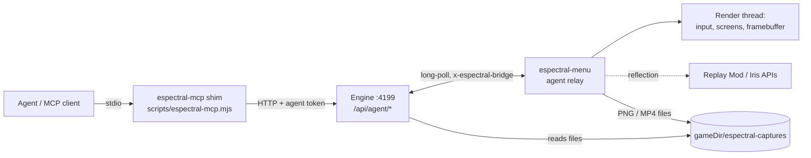

# Agent access & capture — plan (2026-10-30)

Status: **in progress** — P0 done (findings below), P1–P4 being built on
devLIN (see "Handoff" at the bottom). Brainstorm context: the 2026-10-30
session on devWIN1.

## Goals

1. **Testing** — an agent launches the *real* Espectral Client, reaches a known
   state (title / world / server), sees it and drives it: title menu, Suite,
   cosmetics, version ports. Protocol bots (Mineflayer/Azalea) can't do this —
   they never load `espectral-menu`. (Example of a bug only a real client
   catches: 26.3 renumbered mouse buttons, left = 1.)
2. **Content** — an agent shoots screenshots and records short-form video
   (9:16, 60 fps) **with shaders on**.
3. **Users can do the same** — opt-in, connect their own MCP client (Claude
   Code, Codex, Gemini CLI, Cursor…) to their own Espectral Client.

Non-goals: autonomous survival play / pathfinding / combat (Mineflayer's job);
any agent *control* on public Espectral servers.

## Research summary

| Option | Verdict |
|---|---|
| Mineflayer / Azalea | Keep for plugin/server tests and bot swarms. No rendering, no Espectral mod. Azalea is on 26.1; Mineflayer 26.x support unverified. |
| [Mine MCP](https://github.com/hashk014/Mine-MCP) (MIT, 1.14.4–26.3, no Fabric API) | Best reference for the in-client tool surface + safety (127.0.0.1 only, bearer token, F8 pause, 2 s input leases). Phase-0 spike candidate. |
| [Craftwire](https://github.com/uxplima/craftwire) (MIT, 26.2/26.3, needs Fabric API) | Reference for capture: framebuffer → ffmpeg recording, GUI-only transparent capture, detached camera, JSON scenarios. Its own launcher duplicates ours. |
| [mc-mcp](https://github.com/PowerRubik/mc-mcp) | Reference for "player-equivalent input only" (GrimAC-clean). |
| **Replay Mod 2.6.28** | On Modrinth for 1.21.11 / 26.2 / 26.3 (published 2026-10-18), officially supports Iris. Records packets cheaply, renders camera paths **offline, frame-locked** at any resolution via ffmpeg. **GPL-3** → download at install time like our other pins; never bundle or shade into the MIT `espectral-menu` jar; integrate as a soft (reflection) dependency. |
| Iris + Sodium | Already pinned per version in `src/engine/mods.mjs` (26.3: Iris 1.11.7 + Sodium 0.9.2 exactly). |

Key insight for content: real-time capture with shaders on a low-end GPU
(devLIN is an AMD Barcelo iGPU) drops frames. Smooth 60 fps clips on *any* PC
need an **offline, frame-locked render** — Replay Mod already does that with
Iris. Live capture stays useful for test evidence and quick clips.

## What exists today (reuse, don't duplicate)

- Launch API: `POST /api/instances/:name/launch` (`account`, `dry_run`), `POST …/stop`,
  `GET /api/launch/:key/log`, `GET /api/launches`, SSE `/api/events`.
- **Mod bridge** (`src/engine/bridge.mjs`): per-launch random token via
  `-Despectral.bridge.token`, URL via `-Despectral.bridge.url`, header
  `x-espectral-bridge`, registry `attach({instance, uuid, gameDir, token})`.
  Only route today: `POST /api/bridge/visible` (cosmetics presence).
- Version JSONs already carry `--quickPlaySingleplayer` / `--quickPlayMultiplayer`
  / `--width` / `--height` behind feature rules; `expandGameArgs(args, features)`
  in `launch.mjs` evaluates them — we just never enable those features.
- Mod: shared code in `branding-mod/src/main`, per-version overrides in
  `branding-mod/mc12111|mc262|mc263`; entrypoint `es.spectral.menu.EspectralClient`.

## Architecture

- **Relay, not a port in the mod.** The mod only makes outbound calls to the
  engine it already knows (bridge URL + token). The engine owns the stable
  address, auth, multi-client addressing by launch key, and survives game
  restarts.
  - `POST /api/bridge/agent/poll` — long-poll (~25 s), returns queued commands.
  - `POST /api/bridge/agent/result` — `{id, ok, data|error}`.
  - `POST /api/bridge/agent/state` — `{phase: title|loading|joining|in_world|disconnected, screen, server, world}`; engine re-emits as SSE `agent-state`.
  - Commands run on the render thread (`Minecraft.execute`), never on the
    relay thread.
- **Big payloads go through files**, not JSON: the mod writes PNG/MP4 under
  `<gameDir>/espectral-captures/`, the engine (knows `gameDir` from
  `bridge.attach`) reads them. MCP image results return a downscaled preview
  (≤1280 px wide); the full-res path is in the text result.
- **MCP transport: stdio shim** (`src/engine/mcp.mjs` — lives in the engine
  dir so the existing Tauri staging ships it as `resources/engine/mcp.mjs`,
  run by the bundled node). It reads `<data_dir>/agent-token`
  (0600, rotatable) and calls `/api/agent/*` with it. Reason: today non-GET
  routes only need `x-espectral-client: 1` (CSRF guard, not auth) — the agent
  surface needs a real secret. stdio is also the most portable across MCP
  clients.
- **Inert unless enabled.** The relay thread starts only when the JVM has
  `-Despectral.agent=1`, which the engine sets only for agent launches.

## Permission tiers (enforced in the mod; engine mirrors for clear errors)

| Tier | Tools | Allowed where |
|---|---|---|
| observe | `state`, `screen_tree`, `screenshot` (player view), `logs` | anywhere, agent mode on |
| capture | hi-res/portrait screenshot, `record` (player view), `hud`, `shaders` | anywhere (passive — records what the player already sees) |
| camera | detached camera / orbits / Replay Mod paths | singleplayer, replay viewer, spectator mode, or allowlisted servers (freecam on UHC = seeing through walls) |
| act | input, `click`, `type`, `chat`/`command`, GUI slot clicks | singleplayer, replay viewer, `localhost`, `agent.allowed_servers` allowlist. **Refused** on public Espectral hosts by default. |

Safety rails: F8 pauses agent input; held inputs expire after 2 s unless
renewed; opening a screen / world change releases held keys (Mine MCP
semantics). Chat, signs, item names are untrusted text — never instructions.

## Tool surface (v1)

Engine-level (no game needed):
- `launch {instance, account?, join?: {server}|{world}, window?: {width,height,hidden}, wait_for?: "title"|"in_world", timeout_s?}` → `{key, state}`
- `stop {key}`, `state {key}`, `logs {key, cursor?}`, `list_instances`, `list_launches`

In-client (relay):
- `screenshot {width?, height?, hud?: bool, preview?: bool}` — end-of-frame
  capture of the main render target **after** Iris composite. Custom size
  (e.g. 1080×1920, 4K) by resizing the main render target for one frame
  (spike: Iris must rebuild its targets — may need 2–3 frames).
- `screen_tree` — current `Screen` widgets incl. **our own** (title menu,
  Suite, cosmetics): stable id, class, text, bounds, enabled, focused;
  container slots with item id/name/lore.
- `click {id | x,y, button}` / `key {key, action}` / `type {text}` — routed
  through the same `MouseHandler`/`KeyboardHandler` entry points real input
  uses, so version-specific input bugs reproduce.
- `chat {text}` / `command {text}` — act tier.
- `hud {hidden}`; `shaders {enabled?, pack?}` via Iris API v0
  (`net.irisshaders.iris.api.v0.IrisApi` — verify method names on 1.11.7).
- `record start {preset?, width?, height?, fps?, out?}` / `record stop` —
  **live** capture: async PBO readback → `ffmpeg` stdin (rawvideo RGBA →
  H.264). Reports real achieved fps and dropped frames. **With audio**
  (decision 2026-10-30, see Protocol v1 → Audio).
- `clip render {replay?, camera: {orbit|path|keyframes}, preset}` —
  **cinematic** capture via Replay Mod (see below).

Presets: `short` = 1080×1920, 60 fps, HUD off, H.264 CRF 18, ≤60 s;
`landscape` = 1920×1080 60 fps; `evidence` = native size, 30 fps, HUD on.

## Content pipeline (cinematic)

1. Agent launches with Replay Mod present (engine installs the pinned
   Modrinth build when the instance has capture enabled) and plays/stages the
   scene; Replay Mod records packets (cheap, no GPU cost).
2. Agent opens the replay, sets camera keyframes (orbit around a point, path
   through points, time-lapse) through our soft-dependency wrapper over
   Replay Mod's render classes (exact classes on 2.6.28 = spike; fallback is
   driving its GUI through `screen_tree` + `click`).
3. Render with shaders at the preset resolution, frame-locked → MP4 in
   `espectral-captures/`. Slow GPU = slower render, never a choppy video.

ffmpeg: Linux uses the system binary; Windows needs the engine to provision a
static ffmpeg (download + sha256 pin, same pattern as JDK provisioning).
Shader packs: download from Modrinth (project_type `shader`) into
`shaderpacks/` at runtime; never bundle (licences vary).

## Engine changes

- `launch` body gains `agent`, `join`, `window`; map `join` → enable the
  `is_quick_play_singleplayer` / `is_quick_play_multiplayer` features +
  `quickPlay*` placeholders in `expandGameArgs`; `window` → `has_custom_resolution`.
  Hidden window: mod-side (`GLFW_VISIBLE` hint before window creation) when
  `-Despectral.agent.hidden=1`.
- `agent: true` adds `-Despectral.agent=1`, skips Discord presence, tags the
  launch in `/api/launches`.
- New `src/engine/agent.mjs` (command queue per launch key, waiters, timeouts)
  + `src/engine/routes/agent.mjs`. Token check on every `/api/agent/*` route.
- Config: `agent.enabled` (default false), `agent.allowed_servers` (default
  `[]`; singleplayer + localhost are always allowed for act tier).

## User-facing

- Settings → **Acceso para agentes / Agent access** (both es + en strings in
  `lib/i18n-dicts.ts`): toggle, "Copy MCP config" (ready-to-paste JSON for
  Claude Code / Codex / Cursor pointing at the bundled shim), "Rotate token",
  allowlist editor.
- Instance settings: "Capture tools" toggle → installs Replay Mod + makes sure
  Iris/Sodium pins are present.
- Docs page + CHANGELOG entry when shipped.

## Protocol v1 (implementation contract)

Single source of truth for the engine ↔ mod ↔ shim ↔ UI interfaces. Change
it here first, then in code.

### Launch options (engine)

`POST /api/instances/:name/launch` (UI route) and the agent `launch` tool
accept, in addition to `account` / `dry_run`:

- `agent: true` → JVM `-Despectral.agent=1`; no Discord presence for that
  launch; `/api/launches` rows and the launch buffer carry `agent: true`.
  Agent launches also get `-Despectral.ffmpeg=<abs path>` when an ffmpeg is
  known (Linux: `ffmpeg` on PATH; Windows: provisioned, see Engine changes).
- `join: {world: "<save folder>"}` → `--quickPlaySingleplayer <world>`;
  `join: {server: "host[:port]"}` → `--quickPlayMultiplayer host:port`.
  World = existing folder name under `saves/` (no `/`, `\`, `..`); server =
  hostname/IPv4/[IPv6] with optional port. Both → 400.
- `window: {width, height, hidden?}` → `--width W --height H`
  (64…7680 × 64…4320); `hidden: true` (agent launches only) →
  `-Despectral.agent.hidden=1`.
- Fabric launches use the fixed program-arg list (append the flags);
  NeoForge launches go through `expandGameArgs` features
  (`has_custom_resolution`, `is_quick_play_singleplayer`,
  `is_quick_play_multiplayer`) + placeholders.

### Agent access config + token

- Config keys: `agent.enabled` (bool, default false),
  `agent.allowed_servers` (string[] of `host[:port]`, default `[]`).
- Token: `<data_dir>/agent-token`, 64 hex chars + newline, mode 0600, created
  when agent access is enabled (or on first rotate). Never returned by any
  GET.
- UI routes (normal CSRF header, no token):
  - `GET /api/agent-access` → `{enabled, allowed_servers, token_path,
    mcp: {command, args, env}}` — `mcp` is the ready-to-paste server entry
    (`command` = absolute node path, `args` = [absolute `mcp.mjs`],
    `env` = `{ESPECTRAL_DATA_DIR, ESPECTRAL_PORT}`).
  - `PUT /api/agent-access` `{enabled?, allowed_servers?}` → same shape.
  - `POST /api/agent-access/rotate` → same shape (token file rewritten).

### Agent API (shim → engine)

Every `/api/agent/*` request needs `Authorization: Bearer <token>`
(constant-time compare) **and** `x-espectral-client: 1` on non-GET. Errors:
`401 AGENT_AUTH`, `403 AGENT_DISABLED`, `404 NO_LAUNCH`, `409 NOT_AGENT_LAUNCH`
(command to a non-agent launch), `504 AGENT_TIMEOUT`, `502 GAME_GONE`.

| Route | Body / query | Reply |
|---|---|---|
| `GET /api/agent/instances` | — | `{instances:[{name, version, loader, capture_tools}]}` |
| `GET /api/agent/launches` | — | `{launches:[{key, instance, running, agent, state}]}` |
| `POST /api/agent/launch` | `{instance, account?, join?, window?, wait_for?: "title"\|"in_world", timeout_s?=180}` | `{key, state}` (always `agent: true`) |
| `POST /api/agent/stop` | `{key}` | `{ok}` |
| `GET /api/agent/state?key=` | — | `{key, instance, running, state}` |
| `GET /api/agent/logs?key=&cursor=` | — | `{lines, cursor, running}` |
| `POST /api/agent/call` | `{key, tool, args?, timeout_s?=30}` | `{ok:true, data}` \| `{ok:false, error:{code, message}}` |

`state` = the last mod report (below) plus `updated_at`; `null` before the
mod's first report. `call` file results: every `data` field ending in `_path`
holds a path relative to the gameDir; the engine rewrites it to an absolute
path after checking it stays inside `<gameDir>/espectral-captures/`, and for
`preview_path` also adds `preview: {mime: "image/png", base64}`.

### Bridge agent channel (mod → engine)

Headers as today: `x-espectral-client: 1` + `x-espectral-bridge: <token>`.
Only launches started with `agent: true` are served (others → 409).

- `POST /api/bridge/agent/poll` `{}` → long-poll ≤ 25 s →
  `{commands:[{id, tool, args, timeout_ms}], policy:{allowed_servers,
  blocked_hosts}}` (`commands` may be empty). `blocked_hosts` =
  `["uhce.top", "espectral.es"]` (domain suffixes; the mod also blocks the
  IPs they resolve to).
- `POST /api/bridge/agent/result` `{id, ok, data?, error?:{code, message}}`.
- `POST /api/bridge/agent/state` `{phase, screen, server, world, context,
  paused, recording}` → engine stores it per launch, emits SSE
  `agent-state {key, instance, ...state}`. `phase` ∈ `loading|title|joining|
  in_world|disconnected`; `context` ∈ `menu|singleplayer|replay|localhost|
  allowlisted|espectral|server`. Sent on every change and at least every 10 s.

### Tools executed in the mod (`call.tool`)

All run on the render thread. Error codes: `TIER_REFUSED`, `PAUSED` (F8),
`NOT_IN_WORLD`, `NO_SCREEN`, `UNKNOWN_WIDGET`, `BAD_ARGS`, `BUSY`,
`NO_IRIS`, `NO_REPLAYMOD`, `NO_FFMPEG`, `UNSUPPORTED`, `FAILED`.

| Tool | Tier | Args → data |
|---|---|---|
| `screenshot` | observe (capture when `width/height` or `hud:false`) | `{width?, height?, hud?=true, preview?=true}` → `{image_path, preview_path?, width, height}` |
| `screen_tree` | observe | `{}` → `{screen, title, gui_width, gui_height, gui_scale, widgets:[{id, type, class, text, x, y, w, h, enabled, focused, value?}], slots?:[{id, index, x, y, w, h, item, count, name, lore}]}` |
| `click` | act | `{id}` \| `{x, y}` (GUI-scaled coords), `button?="left"`, `double?` → `{}` |
| `key` | act | `{key: "<vanilla key name or short form, e.g. key.keyboard.e / e / escape / f3>", action?: "press"\|"down"\|"up"}` → `{}`; `down` auto-releases after 2 s unless renewed |
| `type` | act | `{text}` → `{}` (char events into the focused widget) |
| `chat` / `command` | act | `{text}` → `{}` |
| `disconnect` | observe | `{}` → `{}` (leave world/server to title; always allowed) |
| `hud` | capture | `{hidden}` → `{hidden}` |
| `shaders` | capture | `{enabled?, pack?}` → `{enabled, pack, available:[…]}` |
| `record_start` | capture | `{preset?="evidence", width?, height?, fps?, audio?=true}` → `{video_path, width, height, fps}` |
| `record_stop` | capture | `{}` → `{video_path, duration_s, frames, dropped, achieved_fps, audio}` |
| `replays` | observe | `{}` → `{replays:[{name, duration_s, date}]}` |
| `clip_render` | camera | `{replay, start_s?, duration_s, preset?="short", camera:{orbit:{center:[x,y,z], radius, height, degrees?=360, start_deg?=0}} \| {path:{points:[[x,y,z,yaw,pitch],…]}}, shaders?: pack, audio?=true}` → `{job}` |
| `clip_status` | observe | `{job, wait_s?≤25}` → `{job, state: "rendering"\|"done"\|"failed", frames_done, total_frames, video_path?, error?}` |

Presets: `short` 1080×1920@60 HUD off; `landscape` 1920×1080@60 HUD off;
`evidence` window size @30 HUD on. H.264 `yuv420p` CRF 18, AAC 48 kHz
stereo audio, `+faststart`.

### Audio

Decision: recordings carry the game's audio. Live `record_*` captures the
game's own mix in-process (OpenAL Soft loopback device or an equivalent tap —
mod's choice, documented in P0/P3 findings) so it is portable and sample-
aligned with the frames; `clip_render` muxes the audio for its replay time
range (from Replay Mod's render if it produces sound, else from a sidecar
recorded alongside the replay). Missing audio never fails a capture: `audio`
in the result says what happened.

### Capture tools (instance)

- Instance field `capture_tools` (bool, default false), set through the
  existing instance PATCH route. Turning it on (Fabric, versions with a pin)
  installs the Replay Mod pin into the instance's mods dir, makes sure the
  Iris/Sodium performance pins are present, and downloads the shader packs
  below into `shaderpacks/` (Modrinth CDN, sha1-verified), selecting the
  default one only when no pack is selected yet. Turning it off removes the
  Replay Mod jar only (shader packs and Iris stay).
- Replay Mod pins (Modrinth project `Nv2fQJo5`, 2.6.28): 1.21.11
  `KJkQjrpd` sha1 `745cc0e46c36f11d377fd4a38ec268791462398a`; 26.2
  `eHbYuA7P` sha1 `4c0a9b4fa4852af576c20083c4f07e4fea1a32f0`; 26.3
  `7c5mnPyr` sha1 `6e6cc19cb5b5a88c2c37dfe567c3d36685ba591b`.
- Shader packs (P0 benchmark): `DEFAULT_SHADER_PACK` = Complementary
  Reimagined r5.9.3 (`HVnmMxH1` / `Bqen1mJX`) for cinematic renders;
  `FAST_SHADER_PACK` = MakeUp Ultra Fast 9.6 (`izsIPI7a` / `t4YRxQug`) for
  live play and live `record`.

## P0 findings (devLIN, 2026-10-30)

**Live fps with shaders** — 26.3 Fabric, Iris 1.11.7 + Sodium 0.9.2 +
Replay Mod 2.6.28, render distance 12, vsync off, 1920×1080 window (same
pixel count as the 1080×1920 `short` preset), creative world seed 1337,
20 s static vista, measured with the mod's own bench harness
(`espectral-bench.json` → `bench-metrics.jsonl`, p50 frame time):

| Shader pack | p50 fps | 1 % low fps |
|---|---|---|
| none | 311 | 112 |
| MakeUp Ultra Fast 9.6 | 33.5 | 25.4 |
| Complementary Reimagined r5.9.3 — VERYLOW / LOW profile | 21.1 / 21.4 | 7.3 / 14.3 |
| Complementary Reimagined r5.9.3 — MEDIUM profile | 15.8 | 10.6 |
| BSL 10.1.8 | 15.7 | 11.4 |
| Complementary Reimagined r5.9.3 — default profile | 13.3 | 10.9 |
| Photon v1.4 | 11.7 | 7.4 |
| Complementary Unbound r5.9.3 | 10.8 | 7.5 |

Consequences: no pack reaches 60 fps live at 1080p on this iGPU, so smooth
60 fps content **must** come from the offline Replay Mod render, where fps
only changes render time. Hence two packs: Complementary Reimagined (best
look that still runs, default profile) for `clip_render`, MakeUp Ultra Fast
for live play / `record` (the only pack above 30 fps).

**Windowing** — 26.3 creates its window through **SDL3** (`Created window
using SDL video driver: wayland`), natively on Wayland, not GLFW/XWayland:
the plan's `GLFW_VISIBLE` idea does not apply on 26.x; hidden mode must use
SDL (hidden window flag / `SDL_HideWindow`) — and 1.21.11 still uses GLFW.

**Replay Mod 2.6.28** — auto-starts recording in singleplayer ("Recording
started"), files in `replay_recordings/`. Public render API (javap):
`ReplayModReplay.instance.startReplay(File)`, `SPTimeline`
(`addPositionKeyframe`, `addTimeKeyframe`, `createTimeline`),
`RenderSettings` (+ `EncodingPreset.MP4_CUSTOM`, export command/arguments),
`VideoRenderer(RenderSettings, ReplayHandler, Timeline).renderVideo()`.
The jar contains no audio writer: its renders are silent, so audio for
`clip_render` has to come from us.

**Iris 1.11.7 API v0** — only `getConfig().setShadersEnabledAndApply(bool)`;
pack switching needs internal `Iris.getIrisConfig().setShaderPackName()` +
`save()` + `Iris.reload()` (reflection).

**Bench harness bug fixed** — the bench never recognised
`EspectralTitleScreen` as the title and re-opened it forever; it now accepts
both titles.

**Process note** — Mine MCP was not tried: driving a native Wayland window
from outside (no per-window input/capture on this session) is exactly what
the relay solves, so the remaining spike items (Replay Mod render time,
hidden window, audio tap) are measured through the relay itself in P2/P3.

## Phases & acceptance (each testable on devLIN)

| Phase | Scope | Acceptance (observed, not assumed) |
|---|---|---|
| P0 spike | Manual: 26.3 instance + Iris 1.11.7 + Replay Mod 2.6.28 + a shader pack; record 20 s singleplayer, render 1080×1920@60. Try Mine MCP jar for tool ergonomics. Check hidden-window behaviour under Wayland/XWayland. | Notes appended here: render time per output second on the Barcelo iGPU, live fps with shaders, Replay Mod render class names, hidden-window result. |
| P1 engine | `agent`/`join`/`window` launch, bridge `state` phases, agent token, stdio shim with `launch/stop/state/logs`. | Fresh MCP client: `launch {instance, join:{world}, wait_for:"in_world"}` returns `in_world`; `npm test` green with new behaviour tests (quickPlay arg mapping, token auth, state transitions). |
| P2 relay + observe/act | poll/result protocol, `screenshot`, `screen_tree`, `click/key/type`, `chat`, tiers, F8. | **Done (2026-10-31, 26.3, in-game).** Agent alone: `screen_tree` on the title menu → clicks into the Suite → toggles *No Fog* → screenshot proves it (and back). `key`/`type` drive vanilla input; `chat`/`command` land in-game. Act tools answer `TIER_REFUSED` on `main.uhce.top` (context `espectral`, latched through the kick), `PAUSED` needs a human F8 (agent `key f8` is refused outright). |
| P3 capture | portrait/hi-res screenshot with shaders, `shaders`, live `record`, Replay Mod `clip render`, ffmpeg provisioning on Windows. | Agent alone produces a 15 s 1080×1920 60 fps MP4 with shaders; `ffprobe` confirms size/fps/duration; sampled frames non-black and visibly shaded. |
| P4 users | Settings UI, MCP config copy, capture toggle, i18n, docs/CHANGELOG. | Real UI driven in a browser + screenshot; `npm run check` 0 errors; copied config works from a clean MCP client. |

Verification recipe per `AGENTS.md` (npm test, npm run check, npm run build,
Gradle for all three mod variants, cargo check if Rust is touched).

## Decisions (human, 2026-10-30)

- **Default shader pack:** the best-looking pack that still runs well on the
  devLIN Barcelo iGPU — measured in P0: Complementary Reimagined for renders,
  MakeUp Ultra Fast for live (see P0 findings).
- **Audio in recordings: yes** (v1, both live `record` and `clip render`).
- **Camera tier:** fine for this work (singleplayer, replay viewer, localhost);
  generally **not** allowed on Espectral servers. A server-granted
  staff/creator permission is out of scope.

## Handoff (devLIN)

- Machine: devLIN = Fedora 44, Wayland, AMD Barcelo iGPU (Mesa), 14 GB RAM,
  Java 21/25, `/usr/bin/ffmpeg`, node. Installed client data at
  `~/.local/share/espectral-client` (instances `Espectral default`,
  `bench-vanilla-26.2`); a repo dev engine uses `<repo>/data/` instead — don't
  mix them.
- Workspace: `~/Documentos/Workspaces/espectrallauncher` (owned by `aitor`;
  run git as `aitor` — root gets "dubious ownership"). `git pull` first: on
  2026-10-30 it sat at `b00fc26`, main is ahead (release 1.6.2 + this doc).
- `npm run deploy:mod` only mirrors into `%LOCALAPPDATA%` (Windows); on Linux
  build with `./gradlew :mc263:build` (etc.) in `branding-mod/` and copy jars
  into the instance yourself, or teach the script the Linux install dir.
- Start with P0 and write the findings into this file before building P1+.

## P2 implementation notes (mod relay, 2026-10-31)

- `es.spectral.menu.agent` (shared `src/main/java`): `AgentRelay` (daemon
  poller + separate 0.5 s state thread; backoff 1→30 s; shutdown hook releases
  held keys), `AgentState`/`AgentStates`/`AgentStatePublisher`, `AgentPolicy`
  (context classifier + blocked-host DNS resolver + startup self-check log
  line), `AgentTools` (tool table + tiers), `AgentScreens` (`screen_tree`),
  `AgentInput` (lease bookkeeping), `AgentCapture` (`screenshot`),
  `AgentPause` (F8), `AgentHud` (paused chip), `AgentTick`.
- Per lane: `AgentInputCompat` (public handlers on 26.3; `@Invoker` mixins for
  `MouseHandler.onButton/onMove` and `KeyboardHandler.keyPress/charTyped` on
  26.2/1.21.11), `Compat.mainRenderTarget`, `AgentHudMixin`
  (`extractRenderState` on 26.x, `render` on 1.21.11).
- Capture hook is `Minecraft.runTick` TAIL — the one frame boundary all three
  lanes share and where the main render target still holds the finished frame.
- Custom-drawn Espectral menus implement `AgentScreenExtras` (the title menu
  turns its `Btn` list into `menu.N` / `icon.N` regions); Suite screens already
  use vanilla widgets, so their ids are `w.N`.
- Context is latched from `--quickPlayMultiplayer` and from every live
  classification: a client kicked off a public server reports
  `phase: disconnected`, `context: espectral`, `server: main.uhce.top`, so act
  tools stay refused on the disconnect screen.
